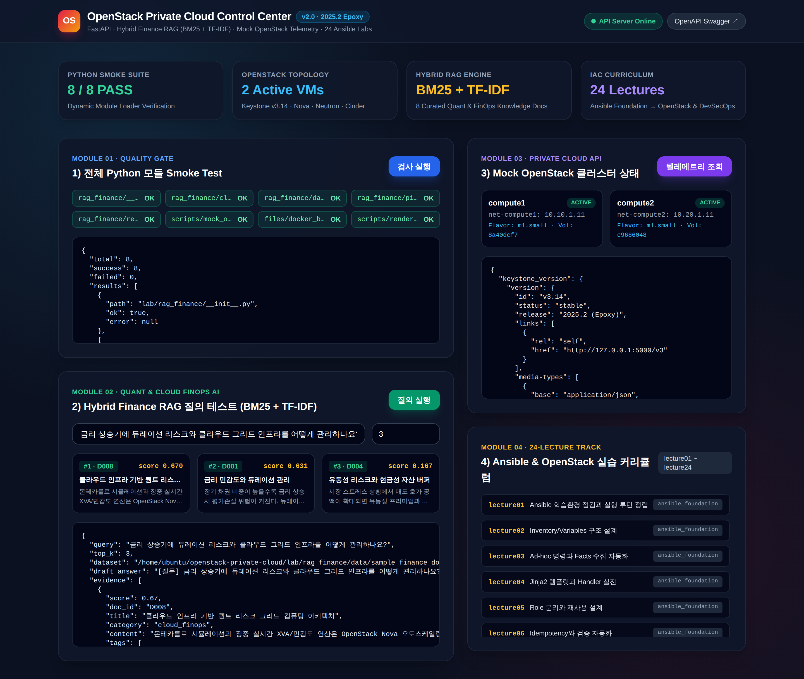
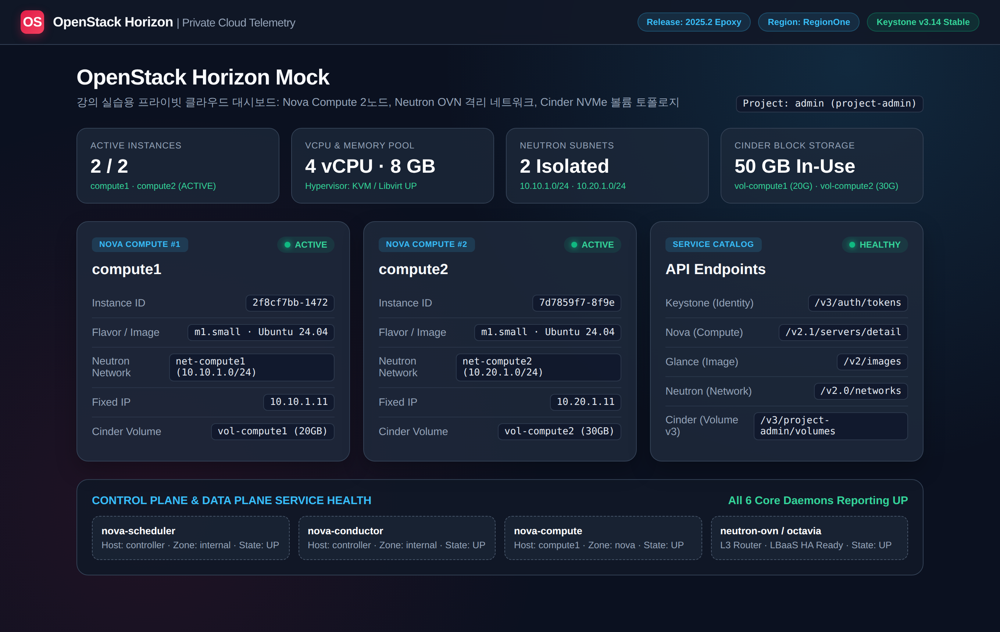
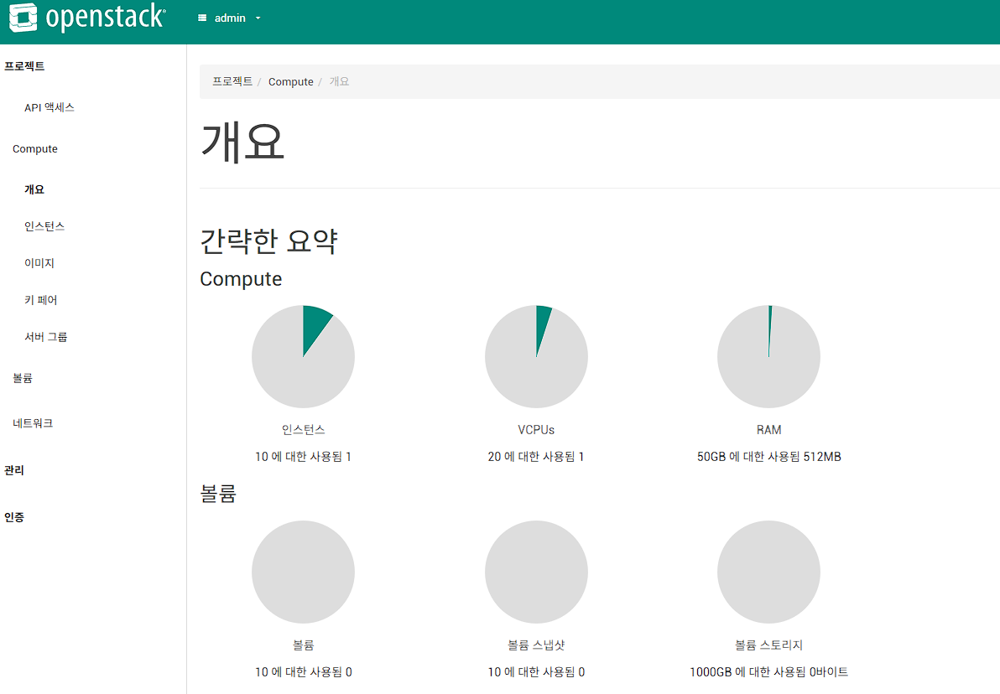
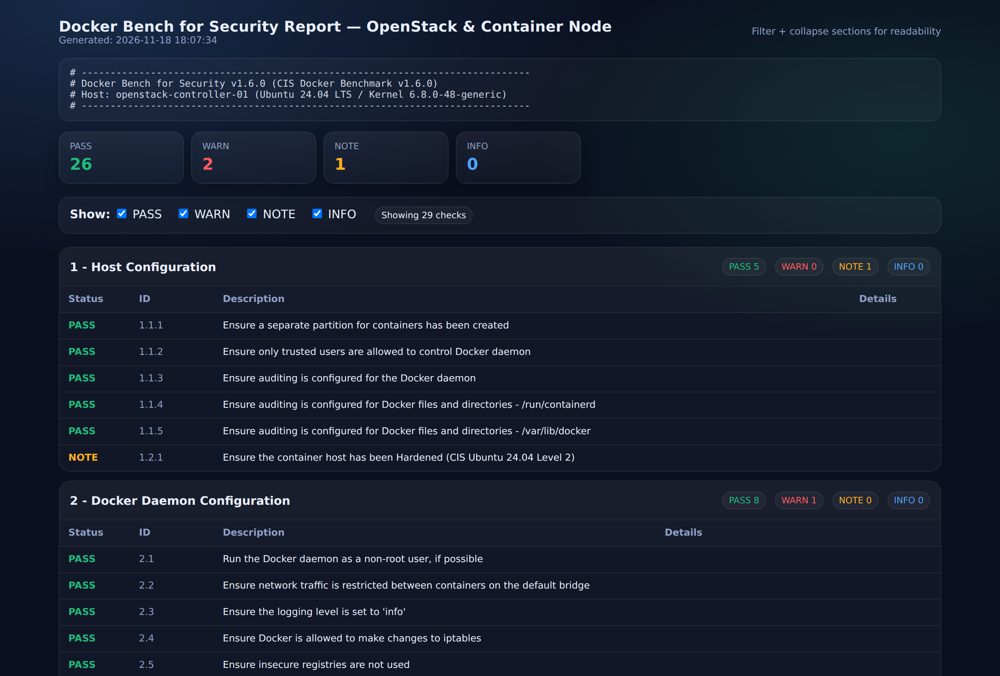
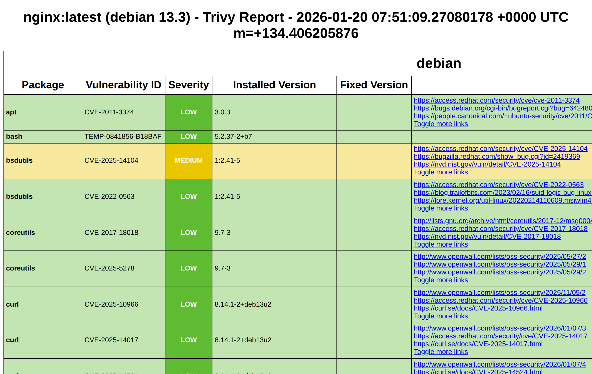
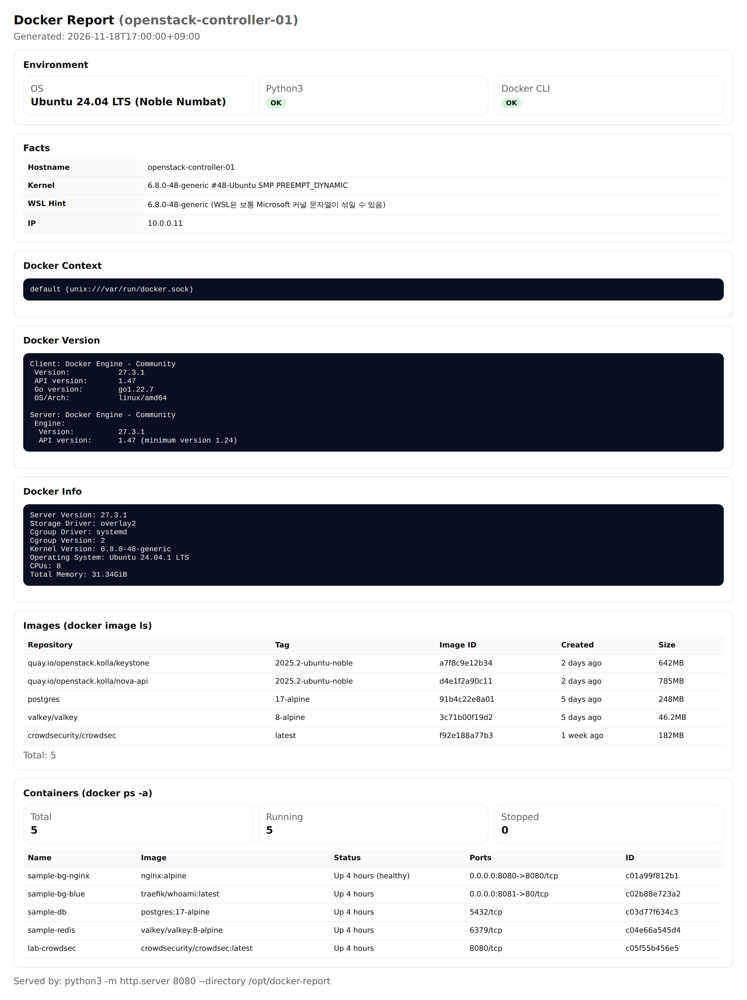
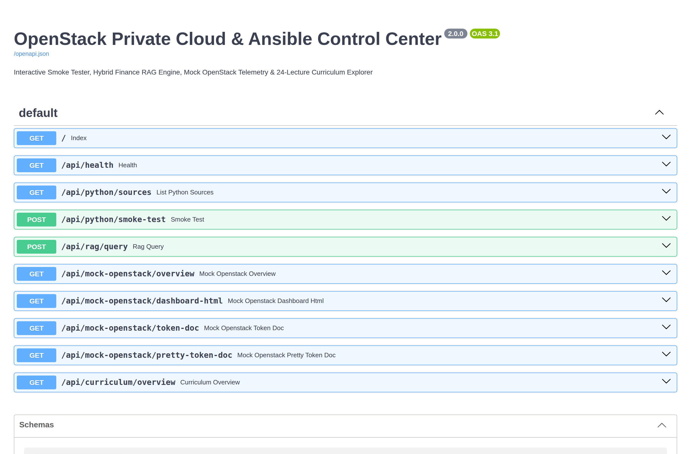

# OpenStack 프라이빗 클라우드 & Ansible IaC 자동화 실습 플랫폼 (v2.0)

<div align="center">

[](README.md)
[](README.ko.md)
[](https://www.openstack.org/)
[](https://docs.ansible.com/)
[](https://www.python.org/)
[](https://fastapi.tiangolo.com/)
[](https://www.packer.io/)
[](LICENSE)

**엔터프라이즈 OpenStack 프라이빗 클라우드(2025.2 Epoxy) 구축, 24강 Ansible IaC 실습 커리큘럼, DevSecOps 보안 감사(Trivy · CIS Docker Bench · CrowdSec), Packer 폐쇄망 OVA 빌더 및 하이브리드 금융/FinOps RAG 통합 관제 센터**

[🇺🇸 Read in English](README.md) · [🚀 1분 빠른 시작](#-1분-빠른-시작-quick-start) · [📸 주요 화면 갤러리](#-주요-기능-화면-캡처-visual-gallery) · [🎓 24강 커리큘럼](#-24강-실습-커리큘럼-로드맵) · [⌨️ OpenStack CLI 완벽 가이드](#-openstack-cli-완벽-가이드)

</div>

---

## 🌟 왜 이 저장소(Repository)를 주목해야 할까요?

엔터프라이즈 환경에서 **OpenStack 프라이빗 클라우드**를 설계·구축하고, **Ansible 코드형 인프라(IaC)**, **퍼블릭-프라이빗 클라우드 브릿지(AWS SSM/VPC)**, **컨테이너 보안(DevSecOps)**, 그리고 **금융/클라우드 FinOps RAG 파이프라인**까지 한 번에 실습할 수 있도록 최신 기술 스택으로 고도화된 올인원 레퍼런스 저장소입니다.

- **☁️ 최신 OpenStack 2025.2 (Epoxy) & Ubuntu 24.04 LTS (Noble) 기반**: 수동 멀티노드 설치, DevStack 자동화, Kolla-Ansible 컨테이너 배포까지 **Keystone, Glance, Nova, Neutron(OVN), Cinder, Swift, Octavia(LBaaS), Horizon** 전 계층을 다룹니다.
- **🤖 체계적인 24단계 Ansible + OpenStack 실습 (`lectures/lecture01` ~ `lecture24`)**: 기초 문법과 멱등성(Idempotency) 검증부터 무중단 Blue/Green 컨테이너 배포, 멀티 컴퓨트 분리 네트워크/볼륨 검증, Octavia HA 로드밸런서까지 단계별로 완주할 수 있습니다.
- **🖥️ 무거운 VM 없이도 즉시 실습 가능한 Mock OpenStack API & FastAPI 웹 관제 센터**: 고사양 서버가 없는 노트북이나 **GitHub Codespaces**에서도 내장된 Mock Keystone/Nova/Horizon 서버와 **FastAPI 다크모드 대시보드**로 모든 기능을 브라우저에서 즉시 검증할 수 있습니다.
- **🛡️ 실무형 DevSecOps 자동 리포트**: **Trivy** 컨테이너 취약점 스캔, **CIS Docker Bench** 보안 규정 준수 HTML 대시보드, **CrowdSec + Nginx** 실시간 침입 탐지 플레이북이 포함되어 있습니다.
- **🧠 하이브리드 금융공학 & 클라우드 FinOps RAG 엔진**: 외부 LLM API 키 없이도 동작하는 **BM25 + Sublinear TF-IDF + 한국어 2-Gram 하이브리드 검색기**를 탑재하여 금융 리스크(듀레이션, VaR/Expected Shortfall) 및 클라우드 그리드 인프라 질의응답을 실습할 수 있습니다.

---

## 📸 주요 기능 화면 캡처 (Visual Gallery)

### 1. OpenStack Private Cloud & Ansible 통합 웹 관제 센터 (`web_tester`)
**FastAPI + Tailwind CSS** 기반의 다크모드 통합 대시보드입니다. 원클릭 **전체 Python 모듈 Smoke Test (8/8 PASS)**, **Hybrid Finance RAG (BM25 + TF-IDF)** 검색 카드, **Mock OpenStack 실시간 텔레메트리**, **24강 커리큘럼 탐색기**를 한 화면에서 제공합니다.



### 2. OpenStack Horizon Mock 대시보드 & 실제 Horizon 운영 콘솔
내장된 멀티스레드 Mock OpenStack 서버(`scripts/mock_openstack_api.py`)가 제공하는 **Horizon Cloud Console (`:5000/dashboard`)** 화면과 실제 구축된 OpenStack Horizon 대시보드(`docs/image.png`) 화면입니다.

| Mock Horizon Cloud Console (`:5000/dashboard`) | 실제 OpenStack Horizon 대시보드 (`docs/image.png`) |
| :---: | :---: |
|  |  |

### 3. DevSecOps 컨테이너 보안 감사 리포트 (CIS Docker Bench & Trivy)
Ansible 보안 플레이북(`91_trivy_scan.yml`, `92_docker_bench.yml`)이 생성하는 대화형 필터링 HTML 리포트 화면입니다.

| CIS Docker Bench 보안 점검 리포트 (`92_docker_bench.yml`) | Trivy 컨테이너 CVE 취약점 리포트 (`91_trivy_scan.yml`) |
| :---: | :---: |
|  |  |

### 4. Ansible 호스트/컨테이너 인벤토리 리포트 & OpenAPI 3.1 Swagger 문서
Jinja2 템플릿(`docker_report.html.j2`)으로 자동 렌더링되는 호스트/컨테이너 상태 리포트와 FastAPI OpenAPI 3.1(`/docs`) 화면입니다.

| Ansible Docker 텔레메트리 리포트 (`docker_report.yml`) | FastAPI OpenAPI 3.1 Swagger UI (`/docs`) |
| :---: | :---: |
|  |  |

---

## 🛠️ 최신 기술 스택 (Modernized Tech Stack)

| 영역 | 핵심 기술 / 컴포넌트 | 적용 버전 / 표준 | 저장소 내 주요 역할 |
| :--- | :--- | :--- | :--- |
| **프라이빗 클라우드** | **OpenStack (Epoxy / Dalmatian)** | `2025.2` / `2024.2` | Keystone, Glance, Nova, Neutron(OVN), Cinder, Swift, Octavia, Horizon |
| **게스트 OS / 하이퍼바이저** | **Ubuntu LTS & VMware / KVM** | `Ubuntu 24.04 LTS (Noble)` | Controller + Compute 2노드 이상 토폴로지 및 Linux Kernel 6.8+ KVM |
| **인프라 자동화 (IaC)** | **Ansible Core & Galaxy** | `>= 2.17` (`2.21` 검증 완료) | 24강 실습 플레이북, 재사용 Role, AWS Dynamic Inventory & SSM 연동 |
| **웹 관제 백엔드/UI** | **Python + FastAPI + Pydantic v2** | `Python 3.11 ~ 3.13` | 웹 컨트롤 센터(`web_tester`), OpenAPI 3.1, 동적 모듈 Smoke Test |
| **금융/FinOps AI 검색** | **Hybrid Lexical-Vector RAG** | `BM25 + TF-IDF + 2-Gram` | 금융공학 리스크 관리 및 클라우드 인프라 질의응답(`lab/rag_finance`) |
| **컨테이너 & 데이터베이스** | **Docker Engine & Compose v2** | `Postgres 17` · `Valkey 8` | 무중단 롤링 배포 및 Blue/Green 트래픽 스위칭(`compose_blue_green`) |
| **보안 감사 (DevSecOps)** | **Trivy, CIS Docker Bench, CrowdSec** | `CIS Benchmark v1.6+` | 컨테이너 이미지 취약점 스캔, CIS 규정 준수 리포트, Nginx 로그 IPS |
| **VM 패키징 / 폐쇄망** | **HashiCorp Packer (HCL2)** | `>= 1.10` (`vmware` 플러그인) | Ubuntu 24.04 자동 설치 및 오프라인/폐쇄망 배포용 OVA 이미지 빌드 |
| **품질 검증 & CI/CD** | **Pytest, Ruff, Ansible-Lint, Molecule** | `Ruff >= 0.7` · `Pytest >= 8.3` | GitHub Actions 매트릭스 CI 및 통합 테스트 스위트(`tests/test_suite.py`) |

---

## 🚀 1분 빠른 시작 (Quick Start)

### 1) FastAPI 웹 관제 센터 & Mock OpenStack 실행 (가상머신 없이 즉시 실행)

```bash
# 1. 저장소 클론 및 이동
git clone https://github.com/edumgt/openstack-private-cloud.git
cd openstack-private-cloud

# 2. 가상환경 생성 및 최신 패키지 설치
python3 -m venv .venv
source .venv/bin/activate
pip install -U pip
pip install -r requirements.txt

# 3. 자동화 테스트(Pytest) 및 린트(Ruff) 검증
pytest -v
ruff check lab/ web_tester/ scripts/mock_openstack_api.py tests/

# 4. 웹 관제 센터 실행 (브라우저에서 http://127.0.0.1:8000 접속)
make web
# 또는 직접 실행: uvicorn web_tester.app:app --host 0.0.0.0 --port 8000 --reload
```

독립 실행형 **Mock OpenStack API (Keystone/Nova/Neutron/Cinder) 및 Horizon 대시보드**를 띄우려면:

```bash
make mock-api
# 브라우저에서 http://127.0.0.1:5000/dashboard 접속!
```

### 2) Ansible 24강 실습 플레이북 실행

```bash
# Ansible Galaxy 컬렉션 및 필수 도구 부트스트랩
make bootstrap

# Lecture 22: 로컬/Codespaces용 Mock Keystone & Nova 서버 기동 및 openrc 자동 생성
ansible-playbook -i ansible/inventories/local/hosts.ini lectures/lecture22/playbook.yml -e install_enabled=false

# Lecture 21: compute1/compute2 + Neutron 분리 네트워크 + Cinder 볼륨 아키텍처 검증
ansible-playbook -i ansible/inventories/local/hosts.ini lectures/lecture21/playbook.yml -e install_enabled=false
```

---

## 🎓 24강 실습 커리큘럼 로드맵

모든 강의는 [`lectures/lecture01`](lectures/lecture01) ~ [`lectures/lecture24`](lectures/lecture24) 경로에 위치하며, 각 폴더는 학습 메타데이터(`lecture.yml`)와 실행 플레이북(`playbook.yml`)으로 구성됩니다.

| 모듈 구분 | 강의 ID | 강의 주제 | 연계 레퍼런스 플레이북 / 문서 |
| :--- | :--- | :--- | :--- |
| **Module 1**<br>Ansible 기초 확립<br>*(Week 1)* | `lecture01` | Ansible 학습환경 점검과 실행 루틴 정립 | `ansible/playbooks/00_ping.yml` |
| | `lecture02` | 다중 환경 Inventory 및 Group Variables 설계 | `ansible/playbooks/00_bootstrap.yml` |
| | `lecture03` | Ad-hoc 명령과 시스템 Facts 수집 자동화 | `ansible/playbooks/learning/01_ping.yml` |
| | `lecture04` | Jinja2 동적 템플릿과 Handler 실전 | `ansible/playbooks/learning/04_template_handler.yml` |
| | `lecture05` | Role 분리 설계와 재사용 아키텍처 | `ansible/playbooks/03_role_web.yml` |
| | `lecture06` | 멱등성(Idempotency)과 상태 검증 자동화 | `ansible/playbooks/check_nginx.yml` |
| **Module 2**<br>서비스 & 컨테이너 운영<br>*(Week 2)* | `lecture07` | 사용자/권한(Sudoers)/SSH 보안 정책 자동화 | `ansible/playbooks/01_users.yml` |
| | `lecture08` | Nginx 웹 서비스 배포와 HTTP 헬스체크 검증 | `ansible/playbooks/02_nginx.yml` |
| | `lecture09` | Docker Engine 설치 및 데몬 표준화 자동화 | `ansible/playbooks/10_docker_engine_install.yml` |
| | `lecture10` | Docker Compose 스택 배포 및 Blue/Green 무중단 전환 | `ansible/playbooks/13_blue_green_switch.yml` |
| **Module 3**<br>클라우드 브릿지 &<br>OpenStack 코어<br>*(Week 3)* | `lecture11` | OpenStack CLI 환경 구성과 Keystone 인증 토큰 흐름 | `lectures/lecture11/playbook.yml` |
| | `lecture12` | OpenStack 프로젝트/네트워크 리소스 자동화 기초 | `ansible/playbooks/20_aws_create_vpc.yml` |
| | `lecture13` | OpenStack 아키텍처와 핵심 서비스(Control vs Compute) 이해 | `docs/openstack/k8s_vs_openstack.md` |
| | `lecture14` | Keystone 인증 / 프로젝트(Tenant) / RBAC 역할 모델 | `lectures/lecture14/playbook.yml` |
| | `lecture15` | Glance 클라우드 이미지(QCOW2) 등록 및 관리 자동화 | `lectures/lecture15/playbook.yml` |
| | `lecture16` | Nova 인스턴스 라이프사이클, Flavor, Keypair 자동화 | `lectures/lecture16/playbook.yml` |
| | `lecture17` | Neutron 가상 네트워크/보안그룹 및 Cinder 블록 스토리지 자동화 | `lectures/lecture17/playbook.yml` |
| **Module 4**<br>OpenStack 운영 & 캡스톤<br>*(Week 4)* | `lecture18` | Horizon 대시보드 운영 점검과 장애 로그 수집 | `lectures/lecture18/playbook.yml` |
| | `lecture19` | Kolla-Ansible 컨테이너 기반 OpenStack 배포 준비와 검증 | `docs/openstack/openstack-nova-ansible-guide.md` |
| | `lecture20` | 종합 캡스톤: 엔터프라이즈 OpenStack 운영 Runbook 완성 | `lectures/lecture20/playbook.yml` |
| **Module 5**<br>멀티노드 & HA 심화<br>*(확장 트랙)* | `lecture21` | Compute 2대 분리 네트워크/볼륨 검증 및 원격 Nginx 배포 | `lectures/lecture21/playbook.yml` |
| | `lecture22` | Codespaces/로컬용 Mock Keystone·Nova API 프로비저닝 | `lectures/lecture22/playbook.yml` |
| | `lecture23` | OpenStack Swift 오브젝트 스토리지 Container/Object 점검 | `lectures/lecture23/playbook.yml` |
| | `lecture24` | OpenStack Octavia 로드밸런서(LBaaS) 및 HA 장애 조치 점검 | `lectures/lecture24/playbook.yml` |

---

## ☁️ AWS vs OpenStack 핵심 리소스 매핑 비교

퍼블릭 클라우드 대표 주자인 **AWS**와 프라이빗 클라우드 표준인 **OpenStack**의 핵심 아키텍처를 1:1로 매핑하여 클라우드 전환 설계를 쉽게 이해할 수 있습니다.

| 리소스 분류 | **AWS (Amazon Web Services)** | **OpenStack** | 주요 역할 및 이 저장소 학습 지점 |
| :--- | :--- | :--- | :--- |
| **컴퓨트 (Compute)** | **EC2** (Elastic Compute Cloud) | **Nova** | 가상 서버(인스턴스) 생성 및 하이퍼바이저 스케줄링 (`lecture16`, `lecture21`) |
| **블록 스토리지** | **EBS** (Elastic Block Store) | **Cinder** | 인스턴스에 탈부착하는 영구 블록 볼륨 및 스냅샷 (`lecture17`, `vol-compute1/2`) |
| **오브젝트 스토리지** | **S3** (Simple Storage Service) | **Swift** / **Ceph** | REST API 기반 컨테이너/오브젝트 대용량 저장소 (`lecture23`, `22_aws_s3_bucket.yml`) |
| **네트워크 (Network)** | **VPC / Subnet / EIP / SG** | **Neutron (OVN)** | 가상 네트워크, 서브넷, 라우터, Floating IP, 보안 그룹 (`lecture12`, `lecture17`) |
| **이미지 관리** | **AMI** (Amazon Machine Image) | **Glance** | VM 부팅용 OS 골든 이미지(Ubuntu 24.04 QCOW2 등) 저장소 (`lecture15`) |
| **인증 및 권한** | **IAM** (Identity & Access Management) | **Keystone** | 멀티테넌트 프로젝트, 사용자 인증, API 토큰, RBAC 권한 관리 (`lecture14`) |
| **로드 밸런서** | **ELB (ALB / NLB)** | **Octavia** | 다중 Compute 인스턴스 트래픽 분산 및 헬스 모니터 기반 HA (`lecture24`) |
| **웹 대시보드 (GUI)** | **AWS Management Console** | **Horizon** | 웹 브라우저 기반 시각적 리소스 관리 및 콘솔 접속 (`lecture18`, `:5000/dashboard`) |

---

## 🖥️ VMware Workstation / KVM 기반 멀티노드 실습 환경 설계

Ansible 자동화 실행 전, 하이퍼바이저 상에서 직접 **Controller + Compute 2노드**와 **3개 분리 네트워크(NAT 인터넷망 / Host-Only 관리망 / VXLAN 터널망)**를 구성하는 아키텍처입니다.

```text
┌─────────────────────────────────────────────────────────┐
│                    Host PC (Windows / Linux)            │
│                                                         │
│  ┌──────────────────────┐  ┌──────────────────────────┐ │
│  │  controller-node     │  │  compute-node            │ │
│  │  Ubuntu 24.04 LTS    │  │  Ubuntu 24.04 LTS        │ │
│  │  vCPU: 4 / RAM: 8GB+ │  │  vCPU: 4 / RAM: 6GB+     │ │
│  │  Disk: 60GB          │  │  Disk: 40GB              │ │
│  │                      │  │                          │ │
│  │  eth0 (NAT)          │  │  eth0 (NAT)              │ │
│  │  192.168.x.x         │  │  192.168.x.x             │ │
│  │                      │  │                          │ │
│  │  eth1 (Host-Only)    │──│  eth1 (Host-Only)        │ │
│  │  10.0.0.11/24        │  │  10.0.0.21/24            │ │
│  │  [관리망 + API]      │  │  [관리망]                │ │
│  │                      │  │                          │ │
│  │  eth2 (Host-Only)    │──│  eth2 (Host-Only)        │ │
│  │  10.0.1.11/24        │  │  10.0.1.21/24            │ │
│  │  [데이터/터널망]     │  │  [데이터/터널망]         │ │
│  └──────────────────────┘  └──────────────────────────┘ │
└─────────────────────────────────────────────────────────┘
```

### Netplan 고정 IP 설정 예시 (`controller-node`: `/etc/netplan/99-openstack.yaml`)

```yaml
network:
  version: 2
  ethernets:
    eth0:
      dhcp4: true
    eth1:
      addresses: [10.0.0.11/24]
    eth2:
      addresses: [10.0.1.11/24]
```

### 단일 노드 DevStack (OpenStack 2025.2 Epoxy) 호스트 자동 준비 플레이북

```bash
ansible-playbook -i ansible/inventories/dev/hosts.ini ansible/playbooks/30_devstack_host_prep.yml
```

---

## ⌨️ OpenStack CLI 완벽 가이드

### 1. 설치 및 버전 확인

```bash
python3 -m venv .venv
source .venv/bin/activate
pip install -U pip
pip install "python-openstackclient>=7.0.0" openstacksdk

openstack --version
```

### 2. `openrc` 인증 파일 및 `clouds.yaml` 구성

```bash
# openrc.sh 예시
export OS_AUTH_URL=http://controller:5000/v3
export OS_PROJECT_NAME="admin"
export OS_USER_DOMAIN_NAME="Default"
export OS_PROJECT_DOMAIN_NAME="Default"
export OS_USERNAME="admin"
export OS_Region_NAME="RegionOne"
export OS_INTERFACE="public"
export OS_IDENTITY_API_VERSION=3
echo "OpenStack 비밀번호를 입력하세요: "
read -sr OS_PASSWORD_INPUT
export OS_PASSWORD=$OS_PASSWORD_INPUT
```

```bash
# 적용 및 토큰 발급 확인
source openrc.sh
openstack token issue
```

### 3. 핵심 서비스별 실무 CLI 치트시트

#### ① 프로젝트 & 사용자 관리 (Keystone)
```bash
openstack project list
openstack project create --domain default --description "Production Cloud Project" prod-project
openstack user create --domain default --password-prompt devops-user
openstack role add --project prod-project --user devops-user member
```

#### ② 이미지 관리 (Glance)
```bash
openstack image list
openstack image create "Ubuntu-24.04-Noble" \
  --file ubuntu-24.04-server-cloudimg-amd64.img \
  --disk-format qcow2 --container-format bare --public
```

#### ③ 네트워크 / 라우터 / 보안 그룹 / Floating IP (Neutron)
```bash
# 격리 네트워크 및 서브넷 생성
openstack network create net-compute1
openstack subnet create subnet-compute1 \
  --network net-compute1 \
  --subnet-range 10.10.1.0/24 \
  --gateway 10.10.1.1 \
  --dns-nameserver 8.8.8.8

# 보안 그룹 및 SSH/HTTP 허용 룰 추가
openstack security group create web-sg --description "Allow SSH and HTTP"
openstack security group rule create --protocol tcp --dst-port 22 web-sg
openstack security group rule create --protocol tcp --dst-port 80 web-sg
```

#### ④ 블록 스토리지 볼륨 & 스냅샷 (Cinder)
```bash
openstack volume create --size 20 vol-compute1
openstack volume list
openstack server add volume compute1 vol-compute1
openstack volume snapshot create --volume vol-compute1 snap-compute1-v1
```

#### ⑤ 컴퓨트 인스턴스 생성 및 운영 (Nova)
```bash
openstack flavor list
openstack keypair create --public-key ~/.ssh/id_ed25519.pub cloud-key

openstack server create compute1 \
  --flavor m1.small \
  --image "Ubuntu-24.04-Noble" \
  --network net-compute1 \
  --security-group web-sg \
  --key-name cloud-key \
  --wait
```

#### ⑥ 오브젝트 스토리지 (Swift) & 로드밸런서 (Octavia)
```bash
# Swift 컨테이너 생성 및 객체 업로드 (lecture23)
openstack container create cloud-backups
openstack object create cloud-backups ./backup-2026.tar.gz

# Octavia 로드밸런서 상태 점검 (lecture24)
openstack loadbalancer list
openstack loadbalancer pool list
```

---

## 🧠 Python 금융공학 & 클라우드 FinOps 하이브리드 RAG Lab (`lab/rag_finance`)

[`lab/rag_finance/`](lab/rag_finance/) 모듈은 대용량 스트리밍 처리에 최적화된 **JSONL 문서 포맷**과 **BM25 + Sublinear TF-IDF + 한국어 음절 2-Gram 하이브리드 검색 엔진**을 결합하여 금융 리스크 및 클라우드 인프라 질의응답을 수행합니다.

- **핵심 문서 토픽 (`sample_finance_docs.jsonl`)**:
  - `D001`: 금리 민감도와 듀레이션 관리 (금리 스왑 IRS 헤지)
  - `D002`: 변동성 급등 구간의 옵션 감마/베가 및 델타 중립 점검
  - `D003`: 선물환(Forward), 통화스왑(CRS) 기반 환율 리스크 헤지
  - `D004`: 스트레스 구간의 고유동성 채권(HQLA) 버퍼 및 Repo 라인
  - `D005`: 신용 스프레드 확대 시 우량 크레딧 재배분 및 CDS 매크로 헤지
  - `D006`: 바젤 III / FRTB 체계의 VaR 한계 보완 및 **97.5% Expected Shortfall (CVaR)**
  - `D007`: 장단기 금리차 역전 이후 **불 스티프닝(Bull Steepening)** 및 컨벡시티 전략
  - `D008`: **OpenStack Nova 오토스케일링 + Cinder NVMe 기반 퀀트 몬테카를로 그리드 컴퓨팅**

```bash
python3 -m lab.rag_finance.cli \
  --query "금리 상승기에 듀레이션 리스크와 클라우드 그리드 인프라를 어떻게 관리하나요?" \
  --top-k 3
```

---

## 📦 Packer 기반 VM 이미지(OVA) 빌드 및 폐쇄망(Air-Gapped) 배포

[`packer/ubuntu.pkr.hcl`](packer/ubuntu.pkr.hcl)을 사용해 Ubuntu 24.04 LTS 기반의 실습용 VMware VM 및 `.ova` 어플라이언스를 자동으로 빌드할 수 있습니다. pip wheel과 Ansible Galaxy 컬렉션이 사전 번들링되어 사내 폐쇄망 환경에서도 즉시 배포 가능합니다.

```bash
# Packer 플러그인 초기화 및 OVA 빌드
packer init packer/
./scripts/build_ova.sh
```

- 상세 가이드: [`docs/vm_image/vmware-setup.md`](docs/vm_image/vmware-setup.md) · [`docs/vm_image/airgap-config.md`](docs/vm_image/airgap-config.md)

---

## 🤝 기여하기 (Contributing) & 라이선스

이 저장소가 클라우드 아키텍처 학습이나 사내 인프라 자동화 표준화에 도움이 되었다면 우측 상단의 **⭐ Star**를 눌러 응원해 주세요!
이슈 제보와 Pull Request는 언제나 환영합니다 (`make test && make lint` 통과 확인).
본 프로젝트는 **MIT License** 하에 배포됩니다.
