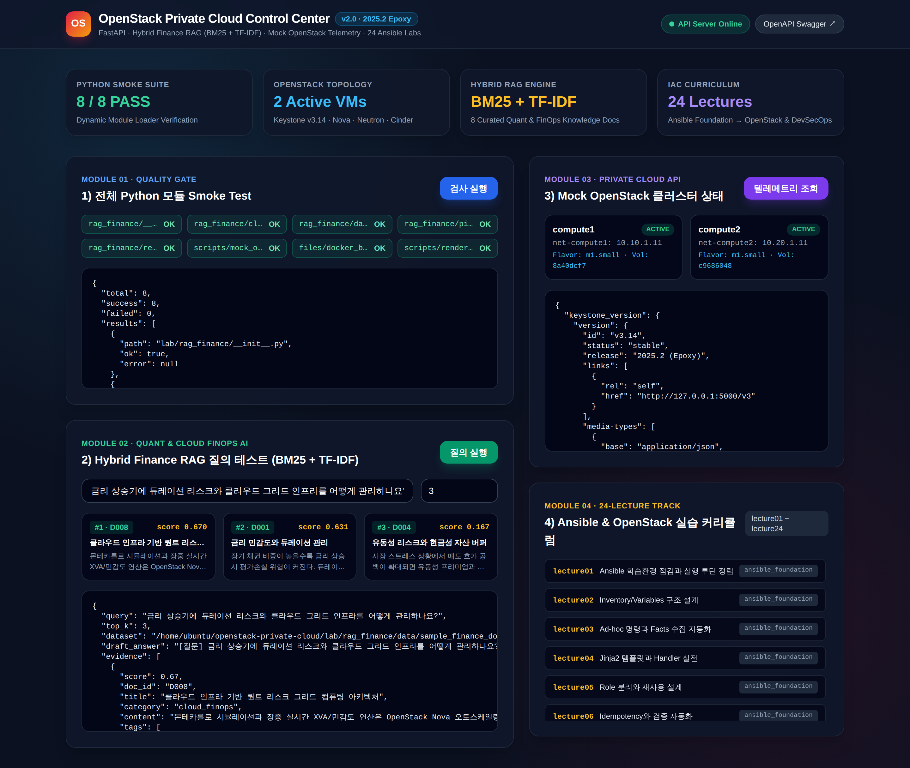
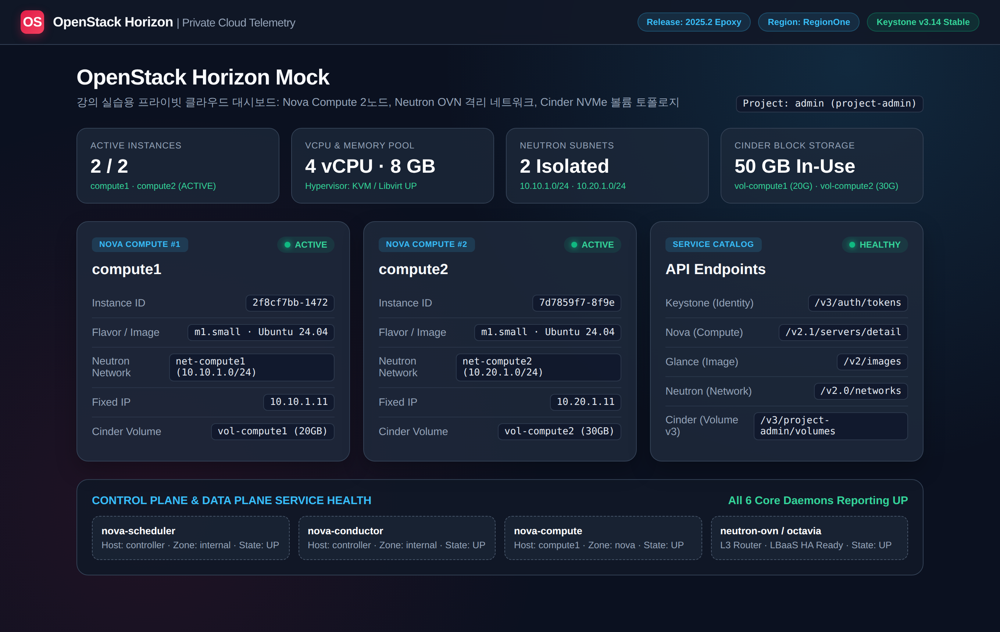
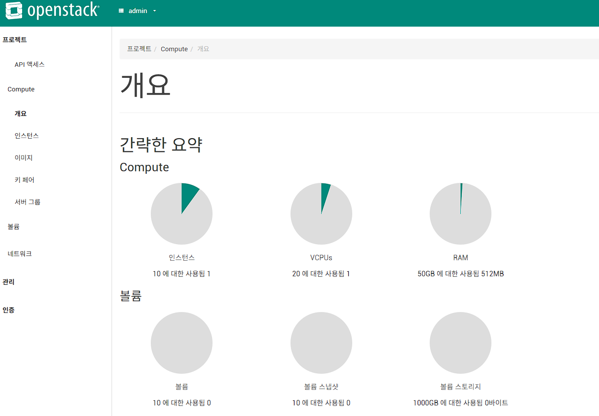
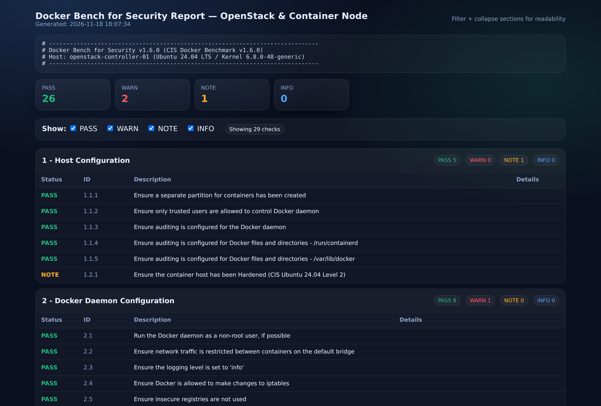
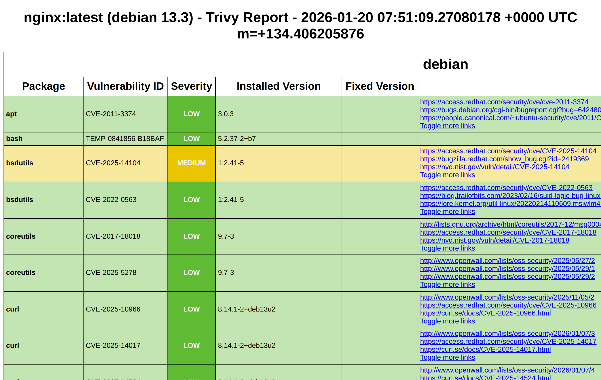
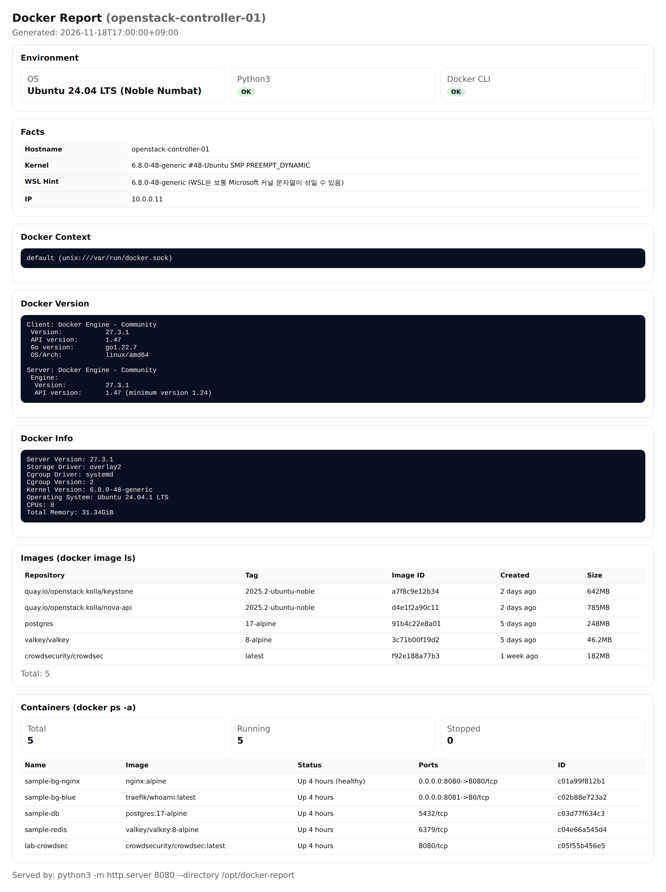
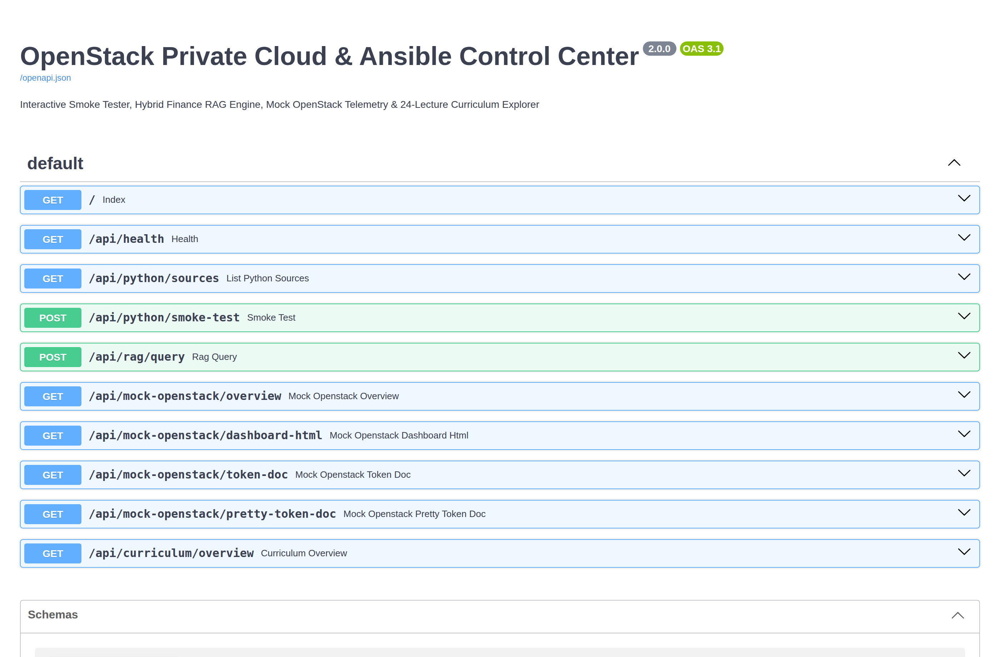
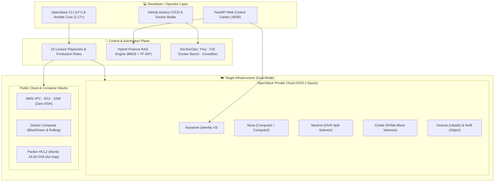

# OpenStack Private Cloud & Ansible IaC Automation Lab (v2.0)

<div align="center">

[](README.md)
[](README.ko.md)
[](https://www.openstack.org/)
[](https://docs.ansible.com/)
[](https://www.python.org/)
[](https://fastapi.tiangolo.com/)
[](https://www.packer.io/)
[](LICENSE)

**End-to-End Enterprise Private Cloud Engineering, Ansible IaC Automation (24 Lectures), DevSecOps Security Scanning (Trivy, CIS Docker Bench, CrowdSec), Packer Air-Gapped OVA Builder & Hybrid Finance RAG Control Center**

[🇰🇷 한국어 문서 보기 (Read in Korean)](README.ko.md) · [🚀 Quick Start](#-quick-start-in-60-seconds) · [📸 Visual Gallery](#-live-platform--visual-gallery) · [🎓 24-Lecture Curriculum](#-24-lecture-curriculum-roadmap) · [☁️ AWS vs OpenStack](#-aws-vs-openstack-architecture--resource-mapping)

</div>

---

## 🌟 Why Star This Repository?

Building and operating an enterprise **OpenStack Private Cloud** while mastering **Ansible Infrastructure-as-Code (IaC)**, **Cloud Bridge (AWS SSM & VPC)**, **Container DevSecOps**, and **AI/RAG Operations** typically requires stitching together dozens of scattered tutorials.

**`openstack-private-cloud`** provides a **single, production-grade, fully verifiable monorepo** that runs anywhere—from a 2-node VMware/KVM hypervisor lab to zero-hardware **GitHub Codespaces** with a built-in **Mock OpenStack API & Horizon Console** and an interactive **FastAPI Web Control Center**.

- **☁️ Modern OpenStack 2025.2 (Epoxy) & Ubuntu 24.04 LTS (Noble)**: Complete manual, DevStack, and Kolla-Ansible architectures covering **Keystone, Glance, Nova, Neutron (OVN), Cinder, Swift, Octavia (LBaaS), and Horizon**.
- **🤖 24-Lecture Hands-On Ansible Curriculum (`lectures/lecture01` ~ `lecture24`)**: Structured 4-week progressive curriculum from Ansible foundations and zero-downtime Blue/Green Docker Compose deployments to multi-node OpenStack & Octavia HA validation.
- **🖥️ Interactive FastAPI Web Control Center & Mock OpenStack Server**: Test every Python module, query the **Hybrid Finance RAG Engine (BM25 + Sublinear TF-IDF + Korean Character N-Gram)**, and inspect live **Mock OpenStack Keystone/Nova/Neutron/Cinder telemetry** in your browser without needing a 32GB RAM server.
- **🛡️ Automated DevSecOps & Compliance Reporting**: Built-in Ansible playbooks for **Trivy** container vulnerability scanning, **CIS Docker Bench for Security** HTML dashboards, and **CrowdSec + Nginx** log-driven intrusion detection.
- **📦 Packer HCL2 OVA Image Builder & Air-Gapped Readiness**: Build reproducible Ubuntu 24.04 VMware/OVA appliances pre-bundled with Python wheels and Ansible Galaxy collections for restricted/offline enterprise networks.

---

## 📸 Live Platform & Visual Gallery

### 1. OpenStack Private Cloud & Ansible Web Control Center (`web_tester`)
An interactive dark-mode engineering console built with **FastAPI + Tailwind CSS** featuring 1-click **Python Smoke Testing (8/8 PASS)**, **Hybrid Finance RAG (BM25 + TF-IDF)** search cards, **Mock OpenStack Cluster Telemetry**, and a **24-Lecture Curriculum Explorer**.



### 2. OpenStack Horizon Mock Dashboard & Real Horizon Telemetry
Run OpenStack CLI & Ansible playbooks anywhere using the built-in multi-threaded Mock OpenStack API (`scripts/mock_openstack_api.py`), or connect directly to a physical multi-node OpenStack Horizon cluster.

| Mock Horizon Cloud Console (`:5000/dashboard`) | Real OpenStack Horizon Overview (`docs/image.png`) |
| :---: | :---: |
|  |  |

### 3. DevSecOps Security & Compliance Dashboards (CIS Docker Bench & Trivy)
Automated security auditing playbooks (`91_trivy_scan.yml`, `92_docker_bench.yml`) parse raw terminal outputs into interactive, filterable HTML security reports.

| CIS Docker Bench Security Report (`92_docker_bench.yml`) | Trivy CVE Vulnerability Report (`91_trivy_scan.yml`) |
| :---: | :---: |
|  |  |

### 4. Ansible Host & Container Telemetry + OpenAPI 3.1 Swagger UI
Generate rich host/container inventory reports via Jinja2 (`docker_report.yml`) and explore every REST endpoint via FastAPI's built-in OpenAPI 3.1 documentation (`/docs`).

| Ansible Docker Telemetry Report (`docker_report.yml`) | FastAPI OpenAPI 3.1 Swagger UI (`/docs`) |
| :---: | :---: |
|  |  |

---

## 🏗️ System Architecture & End-to-End Workflow



---

## 🛠️ Modernized Tech Stack (2025/2026 Edition)

| Category | Technology / Component | Version / Standard | Key Role in This Repository |
| :--- | :--- | :--- | :--- |
| **Private Cloud IaaS** | **OpenStack (Epoxy / Dalmatian)** | `2025.2` / `2024.2` | Keystone, Glance, Nova, Neutron (OVN), Cinder, Swift, Octavia, Horizon |
| **Base OS & Hypervisor** | **Ubuntu LTS & VMware / KVM** | `Ubuntu 24.04 LTS (Noble)` | Multi-node Controller + Compute VM topology & Kernel 6.8+ KVM/Libvirt |
| **IaC & Configuration** | **Ansible Core & Galaxy** | `>= 2.17` (Tested on `2.21`) | 24 Hands-on Lectures, reusable Roles, Dynamic AWS Inventory, SSM connection |
| **Backend & Web UI** | **Python + FastAPI + Pydantic v2** | `Python 3.11 ~ 3.13` | Interactive Control Center (`web_tester`), OpenAPI 3.1, Smoke Test runner |
| **AI / FinOps RAG Lab** | **Hybrid Lexical-Vector Retriever** | `BM25 + TF-IDF + N-Gram` | Quantitative Finance & Cloud FinOps Q&A (`lab/rag_finance`) |
| **Containers & Runtime** | **Docker Engine & Compose v2** | `Postgres 17` · `Valkey 8` | Rolling updates, Blue/Green zero-downtime switching (`compose_blue_green`) |
| **DevSecOps & Audit** | **Trivy, CIS Docker Bench, CrowdSec** | `CIS v1.6+` | Automated CVE scanning, CIS compliance HTML parser, Nginx log IPS |
| **VM Image & Air-Gap** | **HashiCorp Packer (HCL2)** | `>= 1.10` (`vmware` plugin) | Automated Ubuntu 24.04 cloud-init provisioning & offline OVA packaging |
| **Quality & CI Gate** | **Pytest, Ruff, Ansible-Lint, Molecule** | `Ruff >= 0.7` · `Pytest >= 8.3` | Automated linting, unit/integration test suite (`tests/test_suite.py`) |

---

## 🚀 Quick Start in 60 Seconds

### Option A: Launch the Interactive Web Control Center & Mock OpenStack API (No VM Required)

```bash
# 1. Clone the repository
git clone https://github.com/edumgt/openstack-private-cloud.git
cd openstack-private-cloud

# 2. Create virtual environment & install dependencies
python3 -m venv .venv
source .venv/bin/activate
pip install -U pip
pip install -r requirements.txt

# 3. Run the automated Pytest & Ruff quality suite
pytest -v
ruff check lab/ web_tester/ scripts/mock_openstack_api.py tests/

# 4. Start the FastAPI Web Control Center (http://127.0.0.1:8000)
make web
# Or directly: uvicorn web_tester.app:app --host 0.0.0.0 --port 8000 --reload
```

Want to also browse the standalone **Mock OpenStack Horizon Console** and issue real `openstack` CLI commands against it?

```bash
# Start Mock Keystone (:5000), Nova (:8774), and Horizon Dashboard (:5000/dashboard)
make mock-api
# Open http://127.0.0.1:5000/dashboard in your browser!
```

### Option B: Run the 24-Lecture Ansible & OpenStack Lab Playbooks

```bash
# Bootstrap Ansible Core & Galaxy Collections
make bootstrap

# Run Lecture 22 to spin up the Mock OpenStack environment & generate openrc
ansible-playbook -i ansible/inventories/local/hosts.ini lectures/lecture22/playbook.yml -e install_enabled=false

# Run Lecture 21 to verify Keystone, Nova, Neutron split networks, and Cinder volumes
ansible-playbook -i ansible/inventories/local/hosts.ini lectures/lecture21/playbook.yml -e install_enabled=false
```

---

## 🎓 24-Lecture Curriculum Roadmap

All 24 lectures are located under [`lectures/`](lectures/) and follow a unified structure (`lecture.yml` metadata + `playbook.yml` executable lab). Every lecture supports both safe dry-check mode (`-e install_enabled=false`) and full installation mode (`-e install_enabled=true`).

| Track | Lecture | Topic | Core Deliverable / Reference Playbook |
| :--- | :--- | :--- | :--- |
| **Module 1**<br>Ansible Foundation<br>*(Week 1)* | `lecture01` | Ansible Lab Environment & Execution Routine | `ansible/playbooks/00_ping.yml` |
| | `lecture02` | Multi-Environment Inventory & Group Variables Design | `ansible/playbooks/00_bootstrap.yml` |
| | `lecture03` | Ad-hoc Automation & System Facts Collection | `ansible/playbooks/learning/01_ping.yml` |
| | `lecture04` | Jinja2 Dynamic Templating & Handlers in Action | `ansible/playbooks/learning/04_template_handler.yml` |
| | `lecture05` | Reusable Role Architecture (`common`, `webserver`) | `ansible/playbooks/03_role_web.yml` |
| | `lecture06` | Idempotency Guarantees & Automated Health Assertions | `ansible/playbooks/check_nginx.yml` |
| **Module 2**<br>Service & Container Ops<br>*(Week 2)* | `lecture07` | Linux Users, RBAC Sudoers & SSH Hardening | `ansible/playbooks/01_users.yml` |
| | `lecture08` | Nginx Web Server Deployment & HTTP Verification | `ansible/playbooks/02_nginx.yml` |
| | `lecture09` | Docker Engine Installation & Daemon Configuration | `ansible/playbooks/10_docker_engine_install.yml` |
| | `lecture10` | Docker Compose Stacks, Rolling Updates & Blue/Green Switch | `ansible/playbooks/13_blue_green_switch.yml` |
| **Module 3**<br>Cloud Bridge & OpenStack Core<br>*(Week 3)* | `lecture11` | OpenStack CLI Setup & Keystone Token Lifecycle | `lectures/lecture11/playbook.yml` |
| | `lecture12` | OpenStack Project & Neutron Network Automation Basics | `ansible/playbooks/20_aws_create_vpc.yml` |
| | `lecture13` | OpenStack Control Plane vs Compute Node Architecture | `docs/openstack/k8s_vs_openstack.md` |
| | `lecture14` | Keystone Identity: Domains, Projects, Users & RBAC Roles | `lectures/lecture14/playbook.yml` |
| | `lecture15` | Glance Cloud Image Management (Ubuntu 24.04 QCOW2) | `lectures/lecture15/playbook.yml` |
| | `lecture16` | Nova Compute Instance Lifecycle, Flavors & Keypairs | `lectures/lecture16/playbook.yml` |
| | `lecture17` | Neutron Virtual Routers, Security Groups & Cinder Volumes | `lectures/lecture17/playbook.yml` |
| **Module 4**<br>Enterprise OpenStack Ops<br>*(Week 4)* | `lecture18` | Horizon Dashboard Operations & Telemetry Log Collection | `lectures/lecture18/playbook.yml` |
| | `lecture19` | Kolla-Ansible Containerized OpenStack Deployment Prep | `docs/openstack/openstack-nova-ansible-guide.md` |
| | `lecture20` | Capstone: End-to-End OpenStack Production Runbook | `lectures/lecture20/playbook.yml` |
| **Module 5**<br>Advanced Multi-Node & HA<br>*(Extension)* | `lecture21` | 2-Compute Split Network/Volume Verification & Remote Nginx | `lectures/lecture21/playbook.yml` |
| | `lecture22` | Zero-Hardware Codespaces Mock Keystone/Nova Provisioning | `lectures/lecture22/playbook.yml` |
| | `lecture23` | OpenStack Swift Object Storage Containers & Objects Lab | `lectures/lecture23/playbook.yml` |
| | `lecture24` | OpenStack Octavia Load Balancer (LBaaS) & HA Failover | `lectures/lecture24/playbook.yml` |

---

## ☁️ AWS vs OpenStack Architecture & Resource Mapping

One of the fastest ways for public cloud engineers to master **OpenStack** is by mapping its components 1:1 against **Amazon Web Services (AWS)**:

| Resource Layer | AWS Service | OpenStack Service | Architectural Role & Operational Notes |
| :--- | :--- | :--- | :--- |
| **Compute** | **EC2** | **Nova** | Manages VM lifecycle across KVM/Libvirt hypervisor nodes (`compute1`, `compute2`). |
| **Block Storage** | **EBS** | **Cinder** | Persistent block volumes (`vol-compute1`, `vol-compute2`) attached via iSCSI/NVMe/Ceph RBD. |
| **Object Storage** | **S3** | **Swift** / **Ceph RGW** | RESTful container/object storage for images, backups, and unstructured data (`lecture23`). |
| **Networking** | **VPC / Subnet / EIP / SG** | **Neutron (OVN)** | Tenant networks (`net-compute1`), virtual routers, Floating IPs, and Security Groups. |
| **Image Registry** | **AMI** | **Glance** | Stores golden VM templates (`ubuntu-24.04-noble.qcow2`, `cirros`). |
| **Identity & Auth** | **IAM** | **Keystone** | Multi-tenant Projects, Users, Roles, and Application Credentials (`/v3/auth/tokens`). |
| **Load Balancing** | **ELB / ALB / NLB** | **Octavia** | Amphora-based HA Load Balancer as a Service with Health Monitors (`lecture24`). |
| **Web Console** | **AWS Console** | **Horizon** | Web GUI for visual topology inspection, quota management, and VNC console access. |

---

## 🖥️ Multi-Node Private Cloud Topology (Controller + Compute)

For full hypervisor labs on **VMware Workstation Pro 17+** or **KVM**, the repository models a clean 3-network separation (NAT Management, Host-Only API, and VXLAN/Geneve Data Tunnel):

```text
┌─────────────────────────────────────────────────────────────────────────┐
│                         Host Machine (32GB+ RAM)                        │
│                                                                         │
│  ┌───────────────────────────────┐   ┌───────────────────────────────┐  │
│  │  controller-node              │   │  compute-node (compute1/2)    │  │
│  │  Ubuntu 24.04 LTS (Noble)     │   │  Ubuntu 24.04 LTS (Noble)     │  │
│  │  4 vCPU / 8~16 GB RAM / 60GB  │   │  4 vCPU / 6~8 GB RAM / 40GB   │  │
│  │                               │   │                               │  │
│  │  • Keystone, Glance, Horizon  │   │  • Nova Compute (KVM/QEMU)    │  │
│  │  • Nova API/Scheduler         │   │  • Neutron OVN/OVS Agent      │  │
│  │  • Neutron Server, Cinder API │   │  • Cinder Volume / LVM        │  │
│  │  • MariaDB, RabbitMQ, Etcd    │   │                               │  │
│  │                               │   │                               │  │
│  │  eth0 (NAT): Internet         │   │  eth0 (NAT): Internet         │  │
│  │  eth1 (API): 10.0.0.11/24 ────┼───┼─ eth1 (API): 10.0.0.21/24     │  │
│  │  eth2 (Tun): 10.0.1.11/24 ────┼───┼─ eth2 (Tun): 10.0.1.21/24     │  │
│  └───────────────────────────────┘   └───────────────────────────────┘  │
└─────────────────────────────────────────────────────────────────────────┘
```

Need a single-node all-in-one **DevStack (OpenStack 2025.2)** host prepared automatically?
```bash
ansible-playbook -i ansible/inventories/dev/hosts.ini ansible/playbooks/30_devstack_host_prep.yml
```

---

## 🧠 Quantitative Finance & Cloud FinOps Hybrid RAG Lab (`lab/rag_finance`)

Located in [`lab/rag_finance/`](lab/rag_finance/), this module demonstrates how to build a zero-external-API, deterministic **Hybrid Retrieval-Augmented Generation (RAG)** pipeline tailored for **Quantitative Finance Risk Management & Cloud FinOps**:

- **Hybrid Scoring Engine (`retriever.py`)**: Combines **Okapi BM25** ($k_1=1.5, b=0.75$) with **Sublinear TF-IDF Cosine Similarity** and **Korean Character 2-Gram Sub-tokens**, achieving high recall even across Korean morphological inflections.
- **Curated Financial & FinOps Corpus (`sample_finance_docs.jsonl`)**: Covers Duration & Interest Rate Swaps (IRS), Option Gamma/Vega volatility hedging, FX Forwards/CRS, HQLA Liquidity Buffers, Credit Spread CDS, **Basel III FRTB Expected Shortfall (CVaR)**, Yield Curve Bull Steepening, and **OpenStack HPC Monte Carlo Grid Computing**.

```bash
python3 -m lab.rag_finance.cli \
  --query "금리 상승기에 듀레이션 리스크와 클라우드 그리드 인프라를 어떻게 관리하나요?" \
  --top-k 3
```

---

## 📂 Repository Structure

```text
openstack-private-cloud/
├── README.md                      # 🇺🇸 English Documentation (Default Landing Page)
├── README.ko.md                   # 🇰🇷 Comprehensive Korean Guide & Full OpenStack CLI Reference
├── pyproject.toml                 # Modern Python packaging, Ruff linter & Pytest configuration
├── Makefile / Dockerfile          # One-command automation targets & Python 3.13 container image
├── requirements.txt / .yml        # Python & Ansible Galaxy collection dependencies
│
├── web_tester/                    # 🖥️ FastAPI + Tailwind Dark-Mode Control Center (:8000)
│   ├── app.py                     # Smoke Test, Hybrid RAG, Mock OpenStack & Curriculum APIs
│   └── static/index.html          # Interactive Single-Page Engineering Dashboard
│
├── lectures/                      # 🎓 24 Progressive Hands-On Labs (lecture01 ~ lecture24)
│   ├── lecture01~06/              # Module 1: Ansible Foundation
│   ├── lecture07~10/              # Module 2: Linux, Nginx, Docker & Blue/Green Compose Ops
│   ├── lecture11~17/              # Module 3: Cloud Bridge & OpenStack Core Services
│   ├── lecture18~20/              # Module 4: Horizon, Kolla-Ansible & Production Runbook
│   └── lecture21~24/              # Module 5: Multi-Compute, Mock API, Swift & Octavia LBaaS
│
├── ansible/                       # ⚙️ Production-Grade Ansible Assets
│   ├── inventories/               # local / dev / stage / prod / aws dynamic inventory
│   ├── playbooks/                 # 00_bootstrap ~ 20_aws_ssm ~ 30_devstack ~ 93_crowdsec
│   ├── roles/                     # common, webserver, docker_engine, compose_blue_green, aws_ssm_*
│   ├── stacks/                    # Docker Compose v2 stacks (Postgres 17, Valkey 8, Nginx Blue/Green)
│   └── files/                     # CIS Docker Bench HTML parser, CrowdSec & Nginx configs
│
├── lab/rag_finance/               # 🧠 Hybrid BM25 + TF-IDF Financial & FinOps RAG Engine
├── packer/                        # 📦 HashiCorp Packer HCL2 (Ubuntu 24.04 OVA & Air-Gap Builder)
├── scripts/                       # 🔧 Operational scripts & Mock OpenStack Server (Keystone/Nova/Horizon)
├── tests/                         # ✅ Automated Pytest suite (RAG, Mock OpenStack, Web Control Center)
└── docs/                          # 📚 Deep-dive architecture guides & captured dashboard screenshots
    ├── assets/                    # High-DPI screenshots embedded in README
    ├── ansible/                   # Ansible basics to CI/CD guides
    ├── openstack/                 # Kubernetes vs OpenStack, Nova, Swift & Octavia design docs
    ├── finance_rag/               # 8-Module Quantitative Finance RAG curriculum
    └── vm_image/                  # VMware setup & Enterprise Air-Gapped deployment guide
```

---

## 🤝 Contributing & License

Contributions, issues, and feature requests are welcome!
1. Fork the Project & create your feature branch (`git checkout -b feature/amazing-cloud-feature`).
2. Run quality checks locally: `make test && make lint`.
3. Commit your changes and open a Pull Request.

Distributed under the **MIT License**. If this repository helped your cloud engineering journey or team training, please consider giving it a **⭐ Star** on GitHub!
